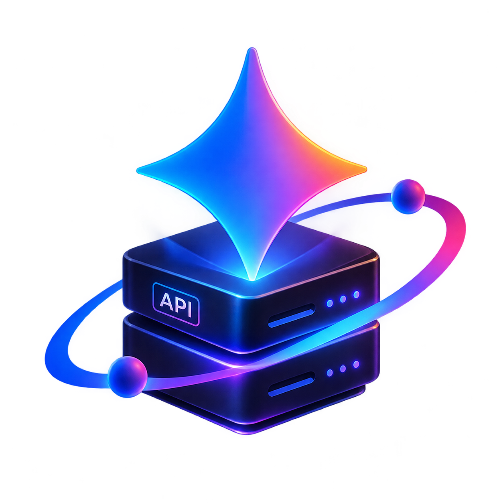

<div align="center">
  
  <h1>Gemini API Proxy</h1>
  <p><strong>An OpenAI compatible proxy for Google Gemini — <em>"You don't need to use VPN anymore :)"</em></strong></p>
  <p>
    <a href="https://gemini-api-proxy-v1.vercel.app/v1">Live API Base URL</a>
    ·
    <a href="https://github.com/MahdiFayyaziMoghaddam/gemini-api-proxy">Repository</a>
  </p>
  <p>
    
    
    
    
  </p>
</div>

---

## Overview

**Gemini API Proxy** is a lightweight [Next.js](https://nextjs.org/) (App Router) service that exposes an **OpenAI-compatible API surface** backed by **Google Gemini**. It forwards supported requests through the official `openai` SDK configured against Gemini's OpenAI-compatible endpoint:

```text
https://generativelanguage.googleapis.com/v1beta/openai/
```

The goal is simple: let tools, scripts, and SDKs that already speak the OpenAI API format work with Gemini with minimal changes — typically by swapping the `baseURL` and providing a Gemini API key.

## Target & Use Cases

This project is built for:

- **Developers in restricted networks** who want a deployable proxy endpoint for accessing Gemini via an OpenAI-style interface.
- **OpenAI SDK users** who want to test or integrate Gemini without rewriting client code.
- **Apps and automations** that already target `/v1/chat/completions`, `/v1/models`, or `/v1/embeddings` and need a compatible backend.
- **Self-hosted/Vercel deployments** where you control the endpoint and use your own Gemini API key per request.

## Features

- **OpenAI-compatible routes** for chat completions, model listing/retrieval, and embeddings.
- **Header-based authentication** using `Authorization: Bearer <API_KEY>`.
- **OpenAI-style error responses** (`{ "error": { message, type, param, code } }`) for validation and upstream failures.
- **Thin proxy architecture** — route handlers delegate to the `openai` SDK with Gemini's compatible base URL.
- **Node.js runtime** route handlers suitable for API proxy workloads.
- **Deployable on Vercel** (or any platform that runs Next.js route handlers).

## Architecture

```text
Client (OpenAI SDK / curl / app)
        │
        │  Authorization: Bearer <GEMINI_API_KEY>
        ▼
Next.js Route Handlers (/app/v1/*)
        │
        │  openai SDK + baseURL=https://generativelanguage.googleapis.com/v1beta/openai/
        ▼
Google Gemini OpenAI-compatible API
```

**Key implementation details:**

- `app/v1/utils.ts` — shared helpers: `getClient(apiKey)`, `getApiKey(headers)`, `createResponse(...)`.
- `app/v1/**/route.ts` — endpoint handlers with request validation and OpenAI-formatted error handling.

## API Reference

| Method | Endpoint               | Description              | Notes                                                                               |
| ------ | ---------------------- | ------------------------ | ----------------------------------------------------------------------------------- |
| `POST` | `/v1/chat/completions` | Create a chat completion | `stream: true` is currently rejected with a `400` OpenAI error (`param: "stream"`). |
| `GET`  | `/v1/models`           | List available models    | Proxied via `openai.models.list()`.                                                 |
| `GET`  | `/v1/models/{model}`   | Retrieve a model         | Proxied via `openai.models.retrieve(model)`.                                        |
| `POST` | `/v1/embeddings`       | Create embeddings        | Proxied via `openai.embeddings.create(body)`.                                       |

## Authentication

All API routes require an API key in the request header:

```http
Authorization: Bearer YOUR_GEMINI_API_KEY
```

If the key is missing, the proxy returns a `401` response in OpenAI error format:

```json
{
	"error": {
		"message": "Missing API key",
		"type": "invalid_request_error",
		"param": null,
		"code": 401
	}
}
```

> Use a valid Google Gemini API key. The proxy forwards authenticated requests to Gemini's OpenAI-compatible endpoint.

## Usage

### Base URL

```text
https://gemini-api-proxy-v1.vercel.app/v1
```

For local development:

```text
http://localhost:3000/v1
```

### cURL — Chat Completions

```bash
curl https://gemini-api-proxy-v1.vercel.app/v1/chat/completions \
  -H "Content-Type: application/json" \
  -H "Authorization: Bearer YOUR_GEMINI_API_KEY" \
  -d '{
    "model": "gemini-2.5-flash",
    "messages": [
      { "role": "user", "content": "Hello from Gemini API Proxy!" }
    ]
  }'
```

### cURL — List Models

```bash
curl https://gemini-api-proxy-v1.vercel.app/v1/models \
  -H "Authorization: Bearer YOUR_GEMINI_API_KEY"
```

### cURL — Embeddings

```bash
curl https://gemini-api-proxy-v1.vercel.app/v1/embeddings \
  -H "Content-Type: application/json" \
  -H "Authorization: Bearer YOUR_GEMINI_API_KEY" \
  -d '{
    "model": "text-embedding-004",
    "input": "Gemini API Proxy makes OpenAI-style clients easy to reuse."
  }'
```

### OpenAI JavaScript/TypeScript SDK

```ts
import OpenAI from "openai";

const client = new OpenAI({
	apiKey: process.env.GEMINI_API_KEY,
	baseURL: "https://gemini-api-proxy-v1.vercel.app/v1"
});

const completion = await client.chat.completions.create({
	model: "gemini-2.5-flash",
	messages: [{ role: "user", content: "Explain this proxy in one sentence." }]
});

console.log(completion.choices[0]?.message?.content);
```

### OpenAI Python SDK

```python
from openai import OpenAI

client = OpenAI(
    api_key="YOUR_GEMINI_API_KEY",
    base_url="https://gemini-api-proxy-v1.vercel.app/v1",
)

completion = client.chat.completions.create(
    model="gemini-2.5-flash",
    messages=[{"role": "user", "content": "Hello!"}],
)

print(completion.choices[0].message.content)
```

## Local Development

### Prerequisites

- **Node.js** (compatible with the project's Next.js/TypeScript setup)
- **pnpm** (project uses `pnpm@11.15.1`)

### Setup

```bash
pnpm install
```

### Run the development server

```bash
pnpm dev
```

Open [http://localhost:3000](http://localhost:3000) for the landing page, and use [http://localhost:3000/v1](http://localhost:3000/v1) as the API base URL.

### Build & start

```bash
pnpm build
pnpm start
```

## Project Structure

```text
app/
  page.tsx                      # Landing page
  layout.tsx                    # App metadata/layout
  v1/
    utils.ts                    # Shared client/auth/response helpers
    chat/completions/route.ts   # POST /v1/chat/completions
    models/route.ts             # GET /v1/models
    models/[model]/route.ts     # GET /v1/models/{model}
    embeddings/route.ts         # POST /v1/embeddings
public/
  icon.png
```

## Error Handling

The proxy aims to return **OpenAI-compatible error objects**. Common cases:

- **Missing API key** → `401` with an OpenAI-style `error` payload.
- **Invalid JSON body** (chat/embeddings) → `400` `invalid_request_error`.
- **Unsupported streaming** (`stream: true` on chat completions) → `400` `invalid_request_error` with `param: "stream"`.
- **Upstream/API errors** → forwarded/normalized to an OpenAI-style `{ error: ... }` response with an appropriate status code when available.

## Deployment

This app can be deployed as a standard Next.js application.

- **Vercel**: import the repository and deploy. The live deployment used by this project is:
  - `https://gemini-api-proxy-v1.vercel.app/v1`
- Ensure your clients send a valid Gemini API key via `Authorization: Bearer ...`.

## Credits

<div align="center">
  <p>Repository: <a href="https://github.com/MahdiFayyaziMoghaddam/gemini-api-proxy">github.com/MahdiFayyaziMoghaddam/gemini-api-proxy</a></p>
  <p>Created by <a href="https://t.me/mhdifyyzi">@mhdifyyzi</a></p>
</div>
